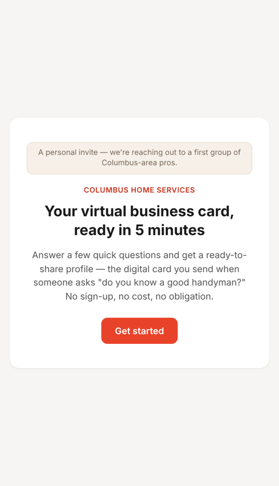
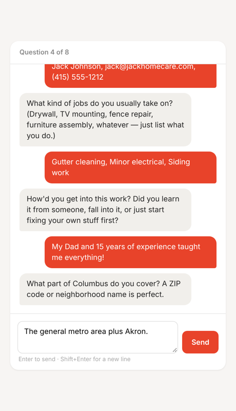
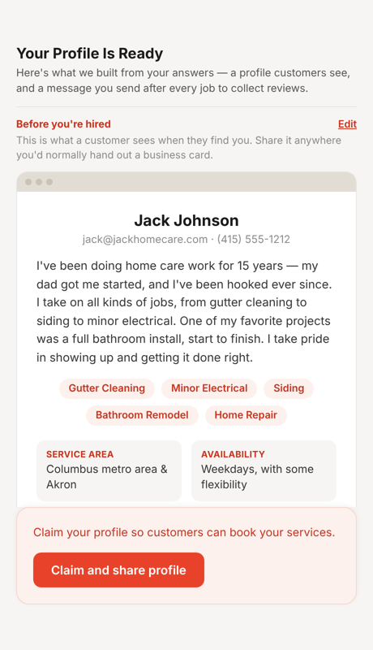
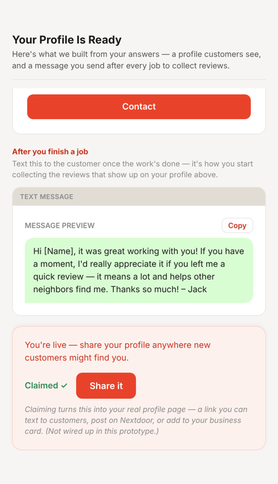

# AI Profile Builder

**A conversational onboarding prototype that turns a local handyman's answers to eight plain-language questions into a ready-to-share profile and a review-request text, using Claude.**

It's the supply-side piece of a product strategy for launching a home-services marketplace on top of a hyperlocal news platform.

<a id="try-it"></a>
**▶ [Try the live prototype](https://claude.ai/artifact/RSAgJpLEWzWwSz1Qe97o3x)** (free Claude sign-in required) &nbsp;·&nbsp; **📄 [Strategy deck (PDF)](docs/local-ai-commerce-strategy-deck.pdf)** &nbsp;·&nbsp; [Deck as text](docs/strategy-deck.md)

| 1. Landing | 2. Conversational intake | 3. Finished profile | 4. Claim & collect reviews |
|---|---|---|---|
|  |  |  |  |

## The problem

Two-sided home-services marketplaces live or die on supply density, and the biggest drop-off on the supply side is the profile. Most handymen don't have a website, don't enjoy writing about themselves, and abandon long sign-up forms. Incumbents either make them fill out forms (Thumbtack, Yelp, Google Local Services Ads) or sell them a paid, custom-built profile (Angi/HomeAdvisor). And a thin profile hurts conversion on the demand side.

This prototype replaces the form with a short chat. It asks the questions a neighbor would ask, then writes the profile for them: free, conversational, and done in minutes.

## How it works

1. **Landing:** a "virtual business card" pitch with no sign-up, no cost, and no obligation.
2. **Conversational intake:** eight questions covering identity, services, background, service area, availability, a job they're proud of, an optional specialty, and how they'd want a neighbor to describe them.
   - Tap-to-add **suggestion chips** lower the effort of the hardest question (services).
   - An **LLM validation step** checks that the services answer is actually a home-services trade and gently redirects once if not.
   - The specialty question is **skippable**, and generation is told never to invent one.
3. **Profile generation:** Claude returns structured JSON (name, contact line, first-person bio, service tags, cleaned-up service area and availability, and a review-request text), parsed defensively.
4. **Output:** two framed previews:
   - **Before you're hired:** the customer-facing profile.
   - **After you finish a job:** a copyable text asking the customer for a review.
5. **Claim:** the conversion moment. Claiming is what would turn the preview into a live, shareable page. (Claim, Edit, and Share are stubbed in this prototype.)

## Product decisions worth noting

- **Chat over form:** every question is answerable in a sentence on a phone; the model does the writing.
- **Pride-based prompts:** "a job you're proud of" pulls out the specific, trustworthy details that generic forms never get, which is what keeps the bio from sounding like AI filler.
- **Grounded generation:** the prompt pulls only from the provider's own answers and refuses to fabricate a specialty.
- **Clean up, don't echo:** vague answers like "the general area" are rewritten into display-ready phrases instead of being shown verbatim.
- **Reviews from day one:** the review-request template gives brand-new providers a way to solve their own cold-start problem.

## Running locally

Requires Node 18+ and an [Anthropic API key](https://console.anthropic.com/).

```bash
npm install
cp .env.example .env   # then add your ANTHROPIC_API_KEY
npm run dev
```

Open the URL Vite prints (usually http://localhost:5173).

Locally, API calls go through the Vite dev-server proxy (`vite.config.js`), which attaches your key on the server side so it's never exposed to the browser. The hosted version on claude.ai uses the page's built-in Claude access instead, so no key is needed there. `callClaude()` in `src/App.jsx` picks whichever is available.

## Project structure

```
├── docs/
│   ├── local-ai-commerce-strategy-deck.pdf   # The designed strategy deck
│   ├── strategy-deck.md                      # Text version of the deck
│   └── images/                               # Screenshots and charts
├── src/
│   ├── App.jsx      # The full prototype: intake flow, Claude calls, profile UI
│   ├── main.jsx
│   └── index.css
├── index.html
├── vite.config.js   # Dev proxy to the Anthropic API
└── .env.example
```

## Status

Prototype. Built to demonstrate the onboarding flow and generation quality, not production-hardened: no persistence, auth, or real messaging.
