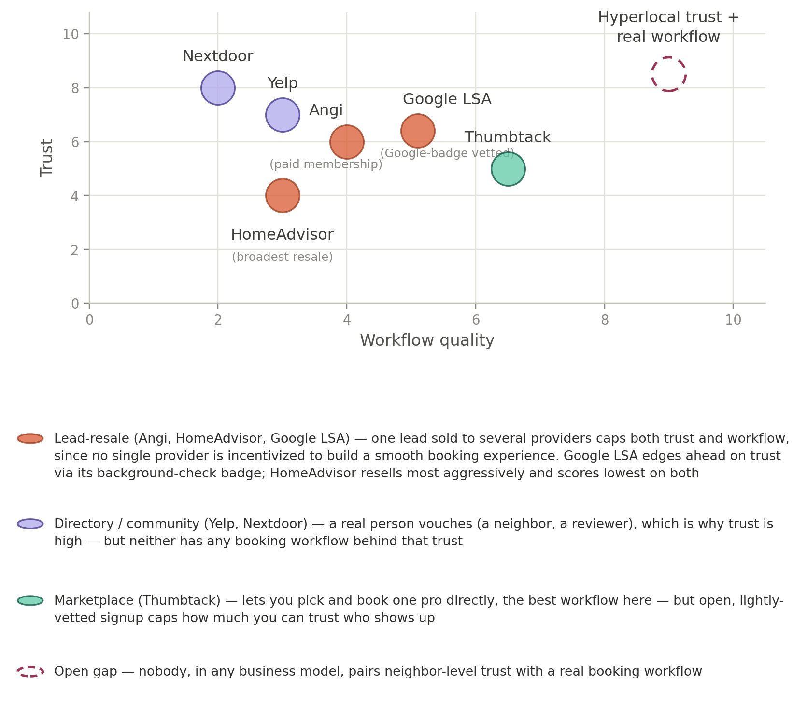
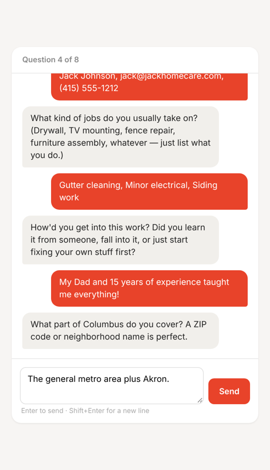
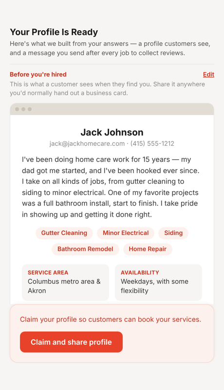
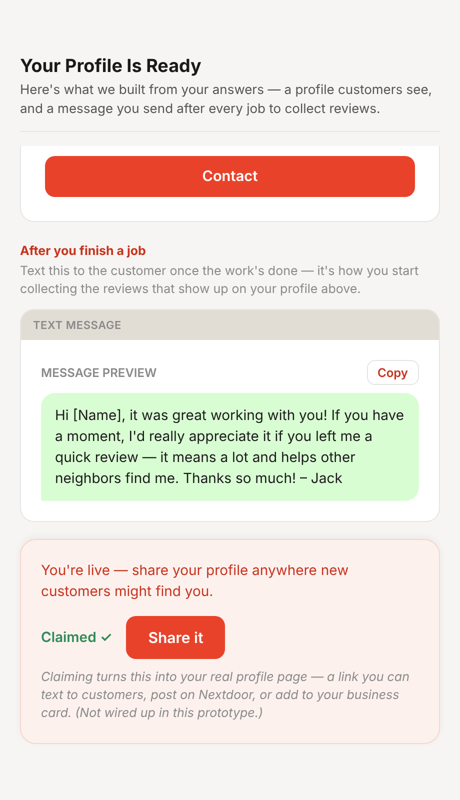

# Local AI Commerce: Home Services Launch Strategy

**Scott Krause** · Product strategy case study for a hyperlocal news platform

> 📄 **[View the full designed deck (PDF)](local-ai-commerce-strategy-deck.pdf)** — this page is a text version for quick reading and search.

**Recommendation:** launch with **handyman services** in the **New Albany corridor** outside Columbus, OH, using a **capped-at-three transparent shared-lead model**, and solve supply first with an **AI-native profile builder**.

---

## What the Platform Already Has vs. What's Missing

- A large local news readership is a ready-made demand base. Most marketplaces spend years and real dollars building this from scratch
- That base is targetable, not just big: the platform's existing interest engine already tracks location, behavior, and intent at zip-code-plus-four resolution, a level of precision most platforms never bother with
- What's still open: supply density in a specific category, and a workflow that converts a reader into a repeat transacting customer
- **The hard part is supply density and workflow. Where you attack that first is a market choice, not just a category choice**

---

## Where the Hard Part Gets Easier: Columbus

- Metro population ~1.76M, growing ~1%/year (~17,600 residents/year). The New Albany/Intel corridor alone (New Albany is a suburb northeast of Columbus where Intel is building a major new plant) is projected to add ~29,000 residents annually (725,000 over 25 years), outpacing the entire metro's growth combined
- Housing supply can't keep pace with that growth (~12,000–13,000 homes/year delivered vs. an estimated 6,000–7,000-unit annual shortfall), meaning most new residents move into existing homes, not new ones
- That existing stock is aging (median home built 1980), and homeowners are staying longer than ever, a record 11 years before selling. It's a repair-and-maintain market, not a flip-and-move market
- Labor is the real constraint, not demand: Intel's $28B semiconductor plant in New Albany (the largest private investment in Ohio history) is absorbing ~7,000 construction workers alone, the same labor pool the marketplace needs on the supply side
- **Net read: concentrated growth, housing that can't be replaced fast enough, and the labor to fix it stretched thin. This is a market that needs home services now, not eventually**

---

## Columbus: Where the Wedge Lives

- Homeownership is bifurcated: city of Columbus proper is only 44% owner-occupied vs. 61% for the metro overall. The suburban ring is where owner-driven repair demand concentrates
- New Albany is the epicenter of both problems: the Intel jobs/housing-shortage zone and a homeowner-heavy suburb at once
- Home values rising steadily (~2.4% YoY, $327,500 median). Appreciating equity makes homeowners more willing to spend on repairs/upgrades
- Launch geography: the New Albany corridor (on the Franklin/Licking County line, northeast of downtown Columbus), not Columbus city proper, not the full nine-county metro

---

## Competitive Landscape

- Lead-resale platforms (Angi, formerly Angie's List; HomeAdvisor; Google LSA, short for Local Services Ads) dominate licensed trades. Reselling one lead to several providers caps both their trust and their workflow quality
- Yelp and Nextdoor earn real trust through genuine referrals, but stop there: neither has any booking workflow behind that trust
- Thumbtack proves a real booking workflow is possible, but open, lightly-vetted signup caps how much you can trust who shows up
- **The gap: no incumbent, in any business model, combines neighbor-level trust with a genuine end-to-end workflow. That's the whitespace handyman services can own**

---

## What We'd Build First: Handyman Services

- Labor supply reality: licensed trades require multi-year apprenticeships and compete directly with Intel's ~7,000 construction workers, making them the hardest category to build supply density in first. Handyman has a lower licensing barrier, faster onboarding, wider labor pool
- Demand shape: aging housing stock + New Albany's wave of new Intel-driven households = a steady stream of small recurring jobs (mounting, patching, punch-list work). This is immediate move-in demand, not a later replacement-cycle
- Competitive gap: handyman is comparatively underserved by structured platforms despite being a high-trust-needed category (someone in your house for a $150 job)
- Lead-model fit: planned, non-emergency jobs favor comparison over speed. Capped-at-three shared leads is a simpler v1 to build than urgent-dispatch routing
- Lead-model and vetting choices are the trust mechanism itself: capped-at-three and founding-cohort vetting are built to avoid the exact failure modes that capped trust and workflow on the competitive map
- Personal credibility: direct precedent launching a handyperson category from zero at Romio, a local services marketplace and former employer of mine

---

## Key Hypotheses & Launch Metrics

*Supply first, since it's the harder, unsolved problem. A small, defensible handful for each, not a dashboard.*

|  | Hypothesis / Criterion | Metric (How We'll Know) |
| --- | --- | --- |
| Supply | Local providers will onboard if the workflow removes their administrative friction | Outreach-to-onboarded conversion (target ~20-25% of providers contacted); response/quote time via seeded test leads in Phase 1 (no live customer volume yet) |
| Demand | Hyperlocal signals already flowing through existing content (a burst-pipe story, a weather event, a home-price post) can be routed into a service flow: a zero-marginal-cost trigger competitors don't have | Intake flows started (top-of-funnel volume); intake-to-quote conversion; quote-to-booking conversion |
| Liquidity (criterion, not a hypothesis) | Name the minimum viable supply density before turning on any demand-side push (e.g., "X qualified providers within Y-mile radius") | Jobs completed per provider per week; geographic density threshold met |

---

## The Product & Prototype

- AI-native intake: hyperlocal NLP (natural language processing) resolving unstructured input to precise geography and job category. This redirects infrastructure the platform already has, not building from scratch
- Lead model v1: capped-at-three transparent shared leads, fitting handyman's planned/non-emergency nature. Exclusive-urgent routing is scoped as a future extension, not v1
- Prototype demo: AI Profile Builder. Turns a handyman's casual, spoken-style answers into a polished, shareable profile in minutes, free and conversational, where every incumbent version is either manual form-filling (Thumbtack, Yelp, Google LSA) or a paid, custom-built product (Angi/HomeAdvisor)
- Precedent: Airbnb's professional-photography investment, proof that improving listing quality itself, not just adding lead volume, is what lifts conversion
- The conversion moment: claiming turns this into a real, shareable profile page, a link providers can text to customers, post on Nextdoor, or add to a business card
- Prototype & code: this repo · [live demo](../README.md#try-it)

---

## Prototype Walkthrough

Four screens from the live prototype: landing, conversational intake, finished profile, and the claim moment.

| 1. Landing | 2. Conversational intake | 3. Finished profile | 4. Claim & collect reviews |
|---|---|---|---|
|  |  |  |  |

---

## GTM: Supply

- Founding-cohort editorial seeding is the recruitment pitch itself: the founding cohort (the first, small group of providers on the platform) joins for the write-up and visibility before there's any lead volume to offer them
- Door-to-door recruiting in the New Albany corridor, following Angie's List's own Columbus-origin playbook (Angie's List is Angi's original name), proof the tactic works in this exact market, not just an analogous one. It also doubles as product discovery: face-to-face conversations with providers surface real onboarding friction and workflow needs before building more than the prototype
- Craigslist is a proven provider channel firsthand, not just a Thumbtack precedent. Posting there as a customer has personally surfaced hundreds of provider replies each time; cross-post recruiting there directly rather than waiting for providers to find us

**Sequencing, not acquisition tactics:**
- Algorithmic surfacing takes over as the scale mechanism once density exists. Editorial seeding and door-to-door recruiting were never meant to scale
- Don't spend demand dollars until qualified density exists

---

## GTM: Demand

- Demand activation is a lever pulled off the platform's existing local reader base, not paid acquisition
- Proven infrastructure (interest engine, intent detection, a large local readership) pointed at a new use case (service flow): a lower-risk GTM bet than most marketplace demand plays
- Beyond intent-triggered flows: a standing "now helping with home repairs" placement in owned inventory builds general awareness ahead of need. It's free, on-brand recall-building, not paid acquisition
- This tech proves demand-side reach, not supply-side matching quality. Pairing the right customer with the right provider is marketplace-ops work, not something the platform's AI does automatically, and it can only be proven once supply is actually built out to match against

---

## Close

- Reiterate the wedge: handyman services, New Albany corridor
- Most confident: the supply wedge, handyman services in the New Albany corridor, backed by direct precedent (Romio) and Columbus-specific labor and housing data
- Want to validate first: whether the content-embedded intent trigger actually converts readers into service-seekers at real volume. This is the newest, least-proven part of the demand hypothesis

---

## Appendix: Expansion Strategy

- Sequencing: funnel depth → segment → geography
- Each stage gated by hitting density/retention thresholds before expanding further
- Licensed trades (plumbing, electrical, HVAC) are the natural second category once handyman density and reputation are established

---

## Appendix: Marketplace Cold-Start Precedents

- Angie's List (now Angi): Columbus-origin door-to-door review-collection founding model
- Thumbtack: Craigslist cross-posting tool for low-friction provider acquisition
- Yelp: database-seeding approach for early content density
- Airbnb: professional photography unlock to build consumer trust at scale
- DoorDash, Rover, Etsy: adjacent two-sided marketplace bootstrapping plays
